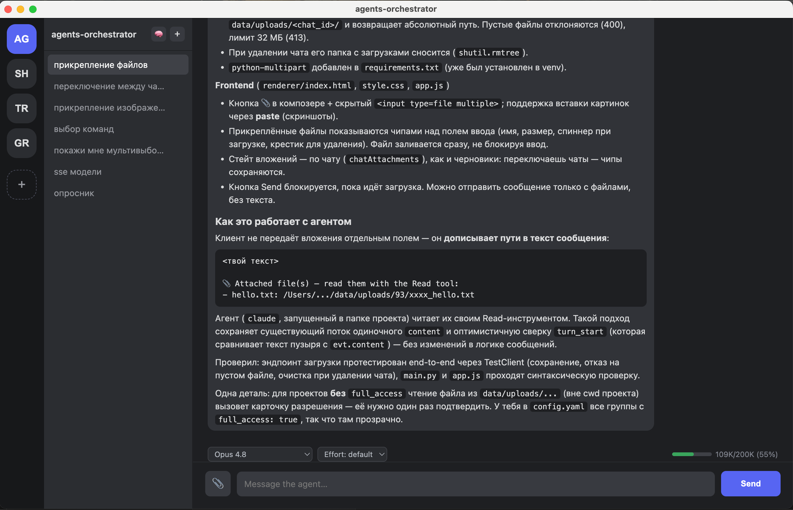

# agents-orchestrator

A Discord-shaped front end for `claude`: every project is a group, every group holds
chats, and each chat is a long-lived CLI session you can steer mid-run. Chats of the
same project share a long-term memory in Qdrant, so a new chat can pick up what an
older one figured out.



## Running it

Memory lives in Docker, the backend and the window on the host:

```sh
npm run db         # Qdrant
npm run backend    # FastAPI + the `claude` CLI, on :8756
npm start          # the Electron window
```

The backend runs where its agents should run — on the host they get your real
toolchain, `.venv`s, `ssh` and services on `localhost`. `docker compose up -d --build`
puts the whole stack in containers instead, UI included on :8080, at the cost of
that toolchain and of needing a token.

Either way the window starts nothing of its own; point it at another machine with
`ORCHESTRATOR_BACKEND=http://box:8756 npm start`.

Day-to-day commands, what to restart after which change, and the failures worth
recognising are in [RUNNING.md](RUNNING.md).

### Authentication

The container runs its own `claude`, and on macOS the desktop login lives in the
Keychain, which a container cannot read. Give it one of these in `.env`:

```sh
claude setup-token     # paste the result as CLAUDE_CODE_OAUTH_TOKEN
# or ANTHROPIC_API_KEY=sk-ant-...
```

Without one, chats fail on the first message with `Agent session failed`.

### Paths

`config.yaml` lists projects by absolute host path, and `PROJECTS_DIR` is mounted into
the backend at that same path — so a group's folder means the same thing on both sides.
Add a project outside `PROJECTS_DIR` and you have to add a mount for it too.

Agent tools run *inside* the container: `git`, `ripgrep` and the Docker client are in
the image, but anything else a project's agent expects has to be added there. To let
agents drive Docker on the host, uncomment the socket mount in `docker-compose.yml` —
that hands the container full control of the daemon.

## Memory

Finished turns are indexed automatically, per project. Agents reach the store through
two tools, `search_memory` and `save_memory`; the 🧠 button in the UI opens the same
store for reading and for writing notes by hand. Embeddings are computed locally with
fastembed — no third service, no API key. Settings live under `memory:` in
`config.yaml`; `MEMORY_*` environment variables override them (compose uses
`MEMORY_URL` to point at the `qdrant` service).

Deleting a chat deletes its memory with it.
